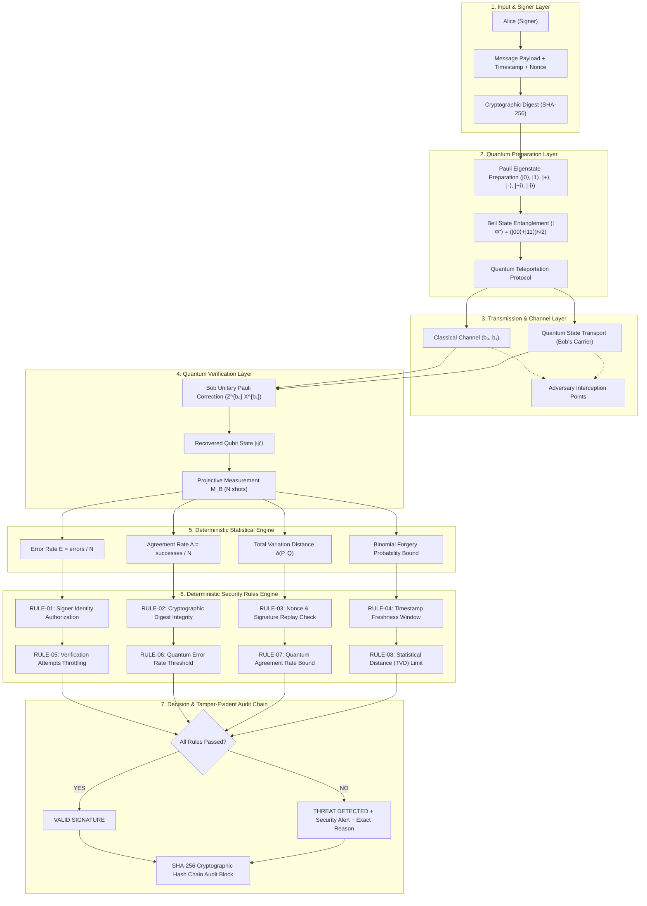

# System Architecture: Quantum-Inspired Cyber Threat Detection

## 1. System Overview

This software system represents an educational and cybersecurity simulation of a teleportation-based Quantum Digital Signature (QDS) verification workflow. The architecture demonstrates how non-classical quantum state correlation and measurement statistics can detect classical forgeries, identity impersonation, replay attacks, channel eavesdropping, and tampering deterministically without using artificial intelligence or machine learning.

## 2. Logical Components

### Frontend (React + Vite)
- **Port:** `5173`
- **Dashboard:** Real-time SOC dashboard displaying live operational statistics, attack telemetry, and recent audit logs.
- **Signature Verification:** Interface for generating signatures and verifying claimed documents against quantum state references.
- **Quantum Simulation:** Educational interactive lab featuring the Bloch sphere, Pauli gate transformations, Bell state density matrices, and sequential 8-step teleportation traces.
- **Attack Simulator:** Interactive cyber attack workbench with adjustable disturbance intensity sliders (0% to 50%) for all 5 threat vectors.
- **Security Analytics:** Quantitative charts assessing Error Rates, False Acceptance Rates (FAR), False Rejection Rates (FRR), and asymptotic security margins.
- **Security Logs & Audit Chain:** Append-only ledger secured by a SHA-256 cryptographic hash pointer chain with one-click verification and tamper simulation.
- **Experiment Lab:** Reproducible scientific testbed with configurable random seeds, trial runners, and JSON export.
- **Quantum Concepts:** Comprehensive educational guide with mathematical formulas and simulation roles.

### Backend (FastAPI + Pydantic + NumPy)
- **Port:** `8000`
- **Quantum Engine:** Pure matrix-mechanics simulation implemented in NumPy adhering to the postulates of quantum mechanics.
- **Hashing Engine:** Standard SHA-256 for document integrity verification.
- **Statistical Engine:** Computes empirical frequencies, Error Rate ($E$), Agreement Rate ($A$), Total Variation Distance ($\delta(P, Q)$), and Kullback-Leibler Divergence ($D_{KL}$).
- **Security Rules Engine:** Eight deterministic evaluation gates with explicit threshold bounds.
- **Tamper-Evident Audit Log:** In-memory append-only blockchain-style ledger linked via SHA-256 hashes ($H_i = \text{SHA256}(H_{i-1} \parallel \text{Event}_i)$).
